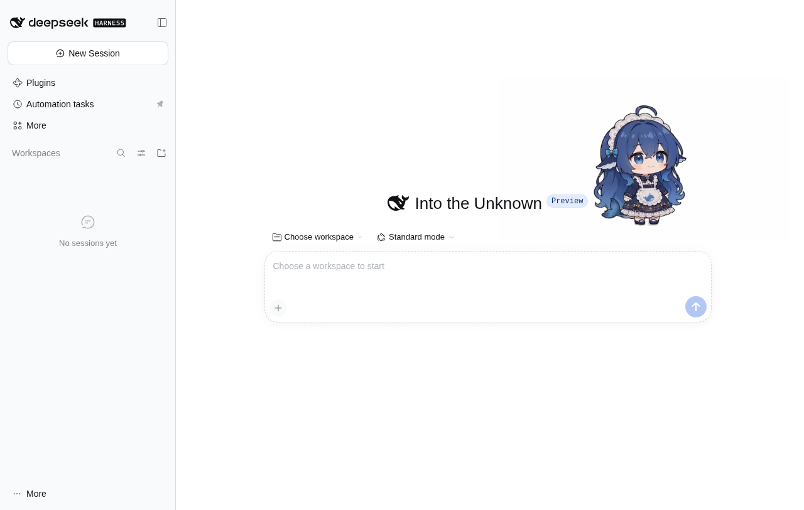
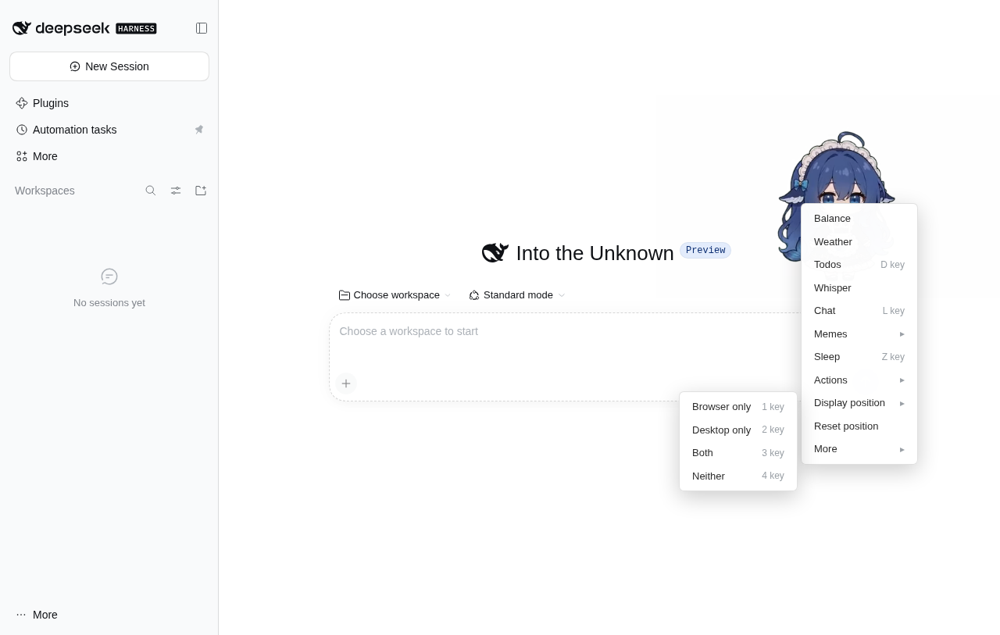
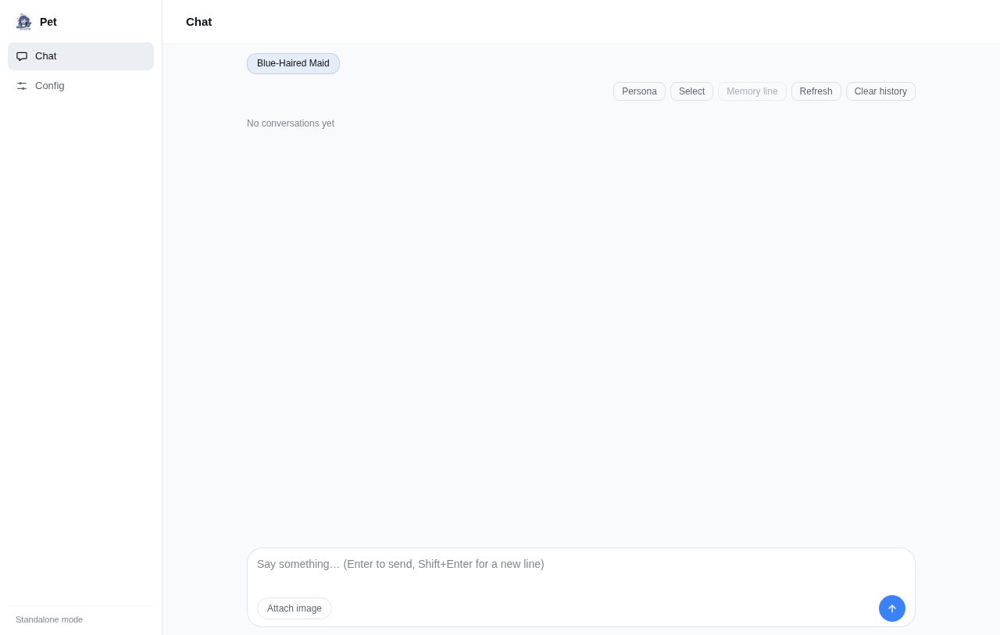
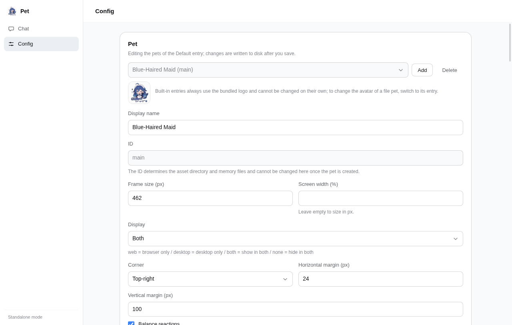

# dsh-pet 🐾

<p align="center">
  <a href="https://www.npmjs.com/package/dsh-pet"></a>
  <a href="https://www.npmjs.com/package/dsh-pet"></a>
  <a href="https://www.npmjs.com/package/dsh-pet"></a>
  <a href="https://github.com/hametovbr/dsh-pet"></a>
  <a href="https://github.com/hametovbr/dsh-pet/blob/main/LICENSE"></a>
  <a href="https://awesome-dsh-plugin.com"></a>
  
  
</p>

**English-localization fork** of [PC2005-cloud/dsh-pet](https://github.com/PC2005-cloud/dsh-pet). The plugin's visible runtime interface is English; the character, artwork, asset pipeline and prompt recipes come from the upstream project and remain its authors' work.

A desktop pet that lives inside [DeepSeek Harness](https://github.com/deepseek-ai/deepseek-harness): idle breathing, random actions (dozing off, solving a Rubik's cube, eating hotpot…), turning left and right, roaming the screen, squishy click reactions, drag-and-throw with bounce and rebound, right-click menu playback — more than a hundred transparent animations that blend seamlessly at any moment. It follows DSH session events to switch its work-status animation, plays a balance animation for the current tier with a speech bubble overhead, mutters to itself and chats with you, and raises a system notification when the window loses focus. Several pets can share one screen, it can leave the browser and live on the **desktop** (a transparent always-on-top window), and you can add **brand-new pet species** (pet packs).

This is not an ordinary plugin but a **complete three-part project**:

```
① Prompt recipes          →  ② Asset pipeline                  →  ③ Plugin
   AI animation recipes        source video → transparent            the pet running inside DSH
                                animation pipeline
```

Anyone who clones this repository can **generate their own desktop pet from scratch** — swap the character, the moves, the style; the whole pipeline is reproducible.

## Localization status

The plugin's visible runtime interface is already English: menus, speech bubbles, tool messages, the settings page, and the default voice (`en-US-AriaNeural`). The comic memes and the animation identifiers keep their original names, because those names are configuration keys and asset file names.

The rest of this repository's documentation is **still Chinese**: [INSTALL.md](INSTALL.md), [FEATURES.md](FEATURES.md), [CONFIG.md](CONFIG.md), [API.md](API.md), [CORDIS.md](CORDIS.md), [CORDIS-API.md](CORDIS-API.md), [MAKE-YOUR-OWN-PET.md](MAKE-YOUR-OWN-PET.md), the OpenAPI spec and the recipes under `prompts/`. This README is the English entry point for now; translating those documents is deferred work, so the Chinese links in the sections below are intentional. The localization process itself and its acceptance evidence are documented in `docs/english-rework/` in Russian — internal fork documents rather than user documentation.

The npm package `dsh-pet@0.4.9` matches upstream, so what npm installs today is the Chinese build. The English localization is currently installed from **this repository** with a source install (see [INSTALL.md](INSTALL.md), still Chinese); publishing the English build to npm is a separate step.

---

## Quick start (install the plugin)

Two ways to install it, pick either:

- **Graphical (inside the desktop app)**: open the Plugins page and type `dsh-pet` into the install box — no terminal needed.
- **Command line**: `dsh plugin --profile <profile> add dsh-pet`, with `<profile>` matching the UI you use — `web` for `dsh web`, `desktop` for the desktop (Electron) app.

> The command above installs from npm, which is the upstream Chinese build. For the English interface, install from this repository's source: clone it, run `npm run build` inside the plugin directory, then `dsh plugin --profile <profile> add file:/path/to/dsh-pet/dsh-pet`; the full walkthrough is in [INSTALL.md](INSTALL.md).

**Don't want DSH?** Standalone mode needs no DSH at all: package the portable Windows x64 bundle from source with `npm run dist` and double-click the `dsh-pet.exe` in `dist-app/win-unpacked/`, or install the CLI globally from npm (`npm install -g dsh-pet`, then run `dsh-pet-standalone`). Both paths are in [INSTALL.md](INSTALL.md) — remember that the npm package is the upstream build, so the English UI comes from the source install described above.

Restart DSH after installing (restart `dsh web` if that is what you use) for it to take effect — a running process keeps the old plugin in memory. The pet lands in the top-right corner of the interface by default.

Prerequisites, the source install, standalone mode usage and packaging, the first Electron download, and what you will see after installing are all covered in **[INSTALL.md](INSTALL.md)** (Chinese for now).

## Plugin features

It only does the desktop pet itself and never touches the DSH kernel; these are all the capabilities it has.

- **100+ animation assets**: idle, walking and roaming, play, work, conversation and every other expression are driven by video animations, chained head-to-tail by weight, and you can swap in your own assets.
- **Multiple pets and species**: raise several at once, each with its own size and position; define custom pet species (pet packs), each species bringing its own set of animations and assets.
- **Three runtime forms**: the browser overlay inside DSH web, the transparent always-on-top window of the DSH desktop app, and a standalone mode that does not need DSH at all.
- **Interaction and physics**: click reactions, drag-and-throw, double-click slingshot, pets colliding with each other — one physics and squash-and-stretch feel for all of them, and the parameters are tunable.
- **Phones and touchscreens**: drag and throw with a finger, sharing the same physics and squash feel as the mouse; in a mobile browser you can also tilt the phone to change the gravity direction, shake it to fling the pet away, and get haptic feedback on collisions — each of the three can be turned off separately under "mobile effects" on the settings page. The sensors only work over HTTPS or localhost (iOS also asks for permission once), and iOS and desktop have no vibration API, so that part is skipped automatically.
- **Muttering and chat**: says something automatically on a timer and you can chat any time; memory persists, images are supported, and replies can be read aloud.
- **Voice (speaking and listening)**: chat replies and manual mutters are spoken; voice, volume and a master switch are configurable; hold the microphone in the chat window to speak a sentence and have the recording transcribed straight into the input box.
- **Balance display**: built-in balance/quota queries for common providers, an animation tier chosen by remaining credit plus a speech bubble; you can also register your own provider.
- **Weather and location**: right-click "Check weather" to look up the current city and conditions once (coarse IP geolocation + Open-Meteo, no key, no setup); the bubble shows temperature, feels-like, humidity, wind speed and a matching weather icon, and this environment also becomes context for the chat.
- **Work-status sync**: switches tier animations following DSH session state and keeps a line of text above its head.
- **Todos**: one sentence plus an optional due time; the list hangs above the pet's head, reminding more often as deadlines approach, and the pet speaks the reminders out loud.
- **Sleep**: right-click "Sleep" to put it to bed, click once or right-click "Wake up" to wake it; while asleep it is completely quiet — random actions, muttering, balance, todos and work status all leave it alone — and it talks in its sleep on a timer; sleep poses can be configured via `animations.sleep` (curled up, lying down, …).
- **System notifications**: a system notification when a task completes or needs confirmation; click it to jump back to the corresponding session.
- **Right-click menu**: switch animations, start a chat, return to the start position, open DSH / the website, reload the configuration.
- **Other**: click sound effects, a system tray icon, and a display position per pet.

Details for every capability are in **[FEATURES.md](FEATURES.md)**; configuration (size / position / multiple pets / physics / model / persona / pet species) is in **[CONFIG.md](CONFIG.md)**.

## 🔌 External API (for other plugins)

The pet does not only play by itself: it **opens two call channels** so other plugins or scripts can drive it and read its state.

- **What it can do**: make it say a given sentence, play a given animation, chat with it; read what it is currently saying, its work status, system notifications and balance, plus its city and the current weather
- **Why it is open**: a desktop pet should not be a mere ornament — a "maid" plugin that has just finished an inspection, for example, can let the pet be its physical voice; and it makes building on top of the pet easy for anyone
- **Channel one · HTTP**: mounted on DSH's own web server (prefix `/dsh-pet-7340`, loopback-only, no authentication), callable across processes and from scripts. Action endpoints reply with `{ok}` only; read data from `GET /state`
- **Channel two · Cordis service**: the client half registers inside the DSH web page, and same-page client plugins get it directly with `ctx.get('petApi7340')` — no network, no port; it is valid only within that page instance, and its methods and returns are in [`CORDIS.md`](CORDIS.md)

The related files (one set for HTTP, one for Cordis):

- [`API.md`](API.md) — HTTP endpoint overview (one line per endpoint, a feature preview)
- [`openapi.yaml`](openapi.yaml) — the full contract (OpenAPI 3.1, imports straight into Swagger UI / Postman)
- [`CORDIS-API.md`](CORDIS-API.md) — Cordis service overview (one line per member, a feature preview)
- [`CORDIS.md`](CORDIS.md) — the exported Cordis service (client half, `ctx.get('petApi7340')` inside the page, no network)
- [`tools/api-tester.html`](tools/api-tester.html) — HTTP-side example: a pet console playing the third-party consumer, easy to try by hand (`node tools/api-tester.cjs` starts it)
- [`tools/cordis-probe`](tools/cordis-probe/README.md) — Cordis-side example: plays a same-page client plugin consuming the service through `ctx.get()`

Those reference documents are **still Chinese** for now (see [Localization status](#localization-status)); the contracts and the `/dsh-pet-7340` prefix are unchanged.

## Compatibility

- **Operating systems**: Windows / Linux / macOS all work — the browser overlay and desktop mode (Electron transparent always-on-top window) behave identically, and Electron is detected or downloaded per platform automatically (`electron.exe` / `Electron.app` / a single Linux binary), with no manual install.
- **Headless / no desktop environment**: Linux headless and other graphical-session-less setups are supported — desktop mode detects the display environment (on Linux, no `DISPLAY` / `WAYLAND_DISPLAY` means no display, so the desktop window is skipped with a log warning), while the browser overlay is unaffected.
- **Browsers**: the browser overlay supports **Chromium-based browsers (Chrome / Edge and others) and Firefox** — transparent animation relies on VP9-Alpha webm and is verified transparent in all three; **Safari is not supported** (macOS does not handle webm alpha and renders the transparency as black) — on macOS use the `.mov` assets (the `assets-mov` release bundle from the upstream project) and drop them in (see section "②.5 Safari/HEVC-compatible assets" in [MAKE-YOUR-OWN-PET.md](MAKE-YOUR-OWN-PET.md)).
- **Multi-monitor**: multi-screen setups are supported — roaming and throwing are bounded by each screen's work area, and heterogeneous scaling (different DPI per screen), taskbar strips and gaps between screens are all detected correctly (landscape / portrait / stacked). "Lock to the current screen" on the settings page keeps the pet (throwing and roaming) on the screen it is currently on.

## Screenshots

What the pet looks like running in the DSH web interface, with the English UI:

<p>
  
  
  
  
</p>

## Animation previews

Every animation (640×360, the very assets the plugin plays) — the GIF previews live in `dsh-pet/assets/preview/` in the repository (referenced directly from the repository; the file names are pinyin to stay cross-platform), and the full transparent videos are in the plugin package under `dsh-pet/assets/webm/` (VP9-alpha, the only published format):

**Idle / turn**

<p>
  
  
</p>

**Movement**

<p>
  
  
  
</p>

**Small actions**

<p>
  
  
  
  
  
  
  
  
  
  
  
  
  
  
  
  
  
  
</p>

**Play**

<p>
  
  
  
  
  
  
  
  
  
  
  
  
  
  
  
  
  
  
  
  
  
  
  
  
  
  
  
</p>

**Food**

<p>
  
  
  
  
  
  
  
  
  
  
  
  
</p>

**Seasonal**

<p>
  
  
  
  
  
  
  
  
  
  
  
  
  
  
  
  
  
  
  
  
  
</p>

**Text**

<p>
  
  
</p>

**Click reactions**

<p>
  
  
  
  
  
</p>

**Drag**

<p>
  
</p>

**Balance events** (tiers by the percentage of balance used: full → tight → exhausted)

<p>
  
  
  
  
  
  
</p>

**Whisper animations** (triggered by muttering or a chat reply, one picked at random)

<p>
  
  
  
</p>

**Work-status animations** (following DSH session events, six tiers: thinking / working / tidying / waiting / success / error)

<p>
  
  
  
  
  
  
</p>

**Sleep** (right-click "Sleep" or hover and press `S`; click once while asleep to wake up)

<p>
  
  
  
</p>

> Note: the animations have a transparent background; in the GIF previews the transparent areas show the page background, while the actual webm plays fully transparent.

## Make your own pet from scratch

AI prompts → green-screen video → transparent animation → plugin; change the character, the moves, the style, and the whole pipeline is reproducible.

The complete walkthrough is in **[MAKE-YOUR-OWN-PET.md](MAKE-YOUR-OWN-PET.md)** (prompt recipes, the asset pipeline, Safari compatibility, publishing).

## Project structure

Only the code and release-related directories are listed; for the asset pipeline's video / scripts / step / pr see section ② of [MAKE-YOUR-OWN-PET.md](MAKE-YOUR-OWN-PET.md) (gitignored local directories are not listed):

```
├── README.md  INSTALL.md  FEATURES.md  MAKE-YOUR-OWN-PET.md  CONFIG.md  API.md  CORDIS.md  openapi.yaml   # readme / install / feature guide / pet-making guide / configuration / HTTP API / Cordis service / OpenAPI spec
├── docs/english-rework/ # localization process docs (Russian): status, plan, glossary, acceptance screenshots
├── HANDOFF.md           # cross-session handoff journal (Russian)
├── .agents/skills/      # repository development skills (task guardrails, plugin and commit standards)
├── prompts/             # ① animation prompt recipes (green-screen rules + per-second breakdown)
├── assets/              # legacy upstream screenshots (Chinese UI); the English ones live in docs/english-rework/acceptance/
├── tools/               # developer tools: API debugging page, cordis-probe mock provider, DPI probe
├── .github/workflows/   # CI: Safari/HEVC transcoding pipeline (macOS runner, manual trigger → assets-mov Release)
├── dsh-pet/             # ③ the plugin (independently publishable to npm)
│   ├── src/
│   │   ├── host/        # host half: configuration / routes / balance / work status
│   │   ├── client/      # browser half: pet rendering / animation chain / settings page
│   │   ├── shared/      # pure logic shared by both halves (physics / menu / data fetching)
│   │   └── standalone/  # standalone-mode CLI (runs the pet directly, without DSH)
│   ├── lib/             # build output (generated by npm run build, not committed)
│   ├── runtime/         # desktop-mode runtime shell (Electron transparent window)
│   ├── assets/          # webm animations / preview GIFs / fonts / icons / config.jsonc default configuration
│   └── scripts/         # build, release and development scripts
└── LICENSE              # MIT
```

## Related projects

- **[aipets](https://github.com/kallen-noelle/aipets)** — a Windows 11 desktop pet with five characters, multiple instances, transparent always-on-top, click-through and inertia when flung. Its distinguishing feature is that **the model picks the actions**: after each conversation round the model chooses an action from the time, weather, battery level and affinity, and when nobody is talking it can even schedule almost a whole day; when the model is unavailable it falls back to built-in rules. Chat connects to any OpenAI-compatible endpoint and includes long-term memory, stickers, image generation and tool calls (web search / Home Assistant / MCP), plus read-aloud and voice input. The same code ships both as a single-file `aipets.exe` desktop build and as a full-page stage version in the browser.

## 💬 Feedback and release cadence

[Issues](https://github.com/hametovbr/dsh-pet/issues) and PRs are welcome — bugs and UX problems, any time. **Open an issue first for a new feature** describing the use case, and start on it only after it is agreed; please do not send an implementation PR before that confirmation. This plugin focuses on the desktop pet and DSH itself, so requests that drift too far away usually will not be built. Before starting, also skim the [commit history](https://github.com/hametovbr/dsh-pet/commits/main) to make sure it is not the same problem already fixed (some issues are fixed on `main` but not released yet).

- **Small fixes are not released on their own**: small bugs and optimizations that do not affect usability are **accumulated** into the next version to avoid overly frequent releases. So "fixed on `main`" does not mean "the version you installed already has it" — when `latest` has not moved, the commit history on `main` is the source of truth.
- **Want an unreleased fix right now**: point the plugin at your local clone with the "install from source" path in [INSTALL.md](INSTALL.md); note that changes on the **host half** need a DSH restart to take effect (the browser half only needs a page refresh).
- **When reporting a bug, please include**: the plugin version, the `dsh` version, the operating system, and reproduction steps (logs or screenshots help).

## License

- Code: MIT
- Assets (animations / prompts / source videos): open-source use is permitted; for the exact grant see the character's image license (see "Character license" below)
- **Derivative-work terms**: derivative / modified / reskinned works based on this project must, on public channels such as a GitHub repository or a product website, include the original author's GitHub address: <https://github.com/PC2005-cloud/dsh-pet>
- **Character origin**: the pet is a community fan-art DeepSeek "big fat fish" (whale girl), **not an official DeepSeek character**; the prototype Mingyue comes from Bilibili [@上善无形](https://space.bilibili.com/4456176), and the DeepSeek version (maid whale girl) was designed by Bilibili [@ZipZipPipe](https://space.bilibili.com/4168597)
- **Character license**: [CC BY-NC-SA 4.0](https://creativecommons.org/licenses/by-nc-sa/4.0/deed.en) (Attribution · NonCommercial · ShareAlike), [original statement](https://www.bilibili.com/opus/1247156596114456581): "The big fat fish is a character released under CC BY-NC-SA 4.0 and must not be commercialized in any form. If you love the character and wish it had a physical form, you are welcome to have one made for yourself."
